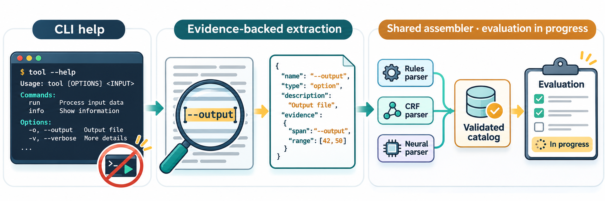

# HelpCat

**Turning command-line help into evidence-backed structured data.**

Command-line help is a convenient interface for people, but its layouts vary across tools and versions. Downstream software often needs the same information in a consistent form—and a parser that guesses from prose or runs the documented program is hard to trust. HelpCat explores a safer, auditable path: extract a catalog from help text supplied by the caller, and retain the exact evidence behind each result.



## Try it

Requires Python 3.12 or 3.13 and [uv](https://docs.astral.sh/uv/).

```sh
uv sync --locked
cat <<'DEMO' | uv run helpcat parse - --command demo
Usage: demo [OPTIONS]

Options:
  -v, --verbose  Show progress.
DEMO
```

The CLI writes a validated JSON catalog to stdout and diagnostics to stderr. Every source-derived field carries an evidence span, extraction rule and provenance. Lines are one-based; columns are zero-based, half-open Unicode character offsets.

Parse a saved help page or query a catalog:

```sh
uv run helpcat parse help.txt --command tar
uv run helpcat query catalog.json --flag=-x
```

Use the library directly:

```python
from helpcat import ParserEngine, parse_help

engine = ParserEngine()  # Reuse for multiple pages.
catalog = parse_help(
    "Options:\n  -v, --verbose  Show progress.\n",
    command_path=("demo",),
    engine=engine,
)
```

## What we are building

The goal is to test whether learned line classification can improve option extraction over deterministic rules while preserving high precision, useful coverage and auditable evidence. Both rules and learned taggers feed one shared assembler, so differences in line labeling do not change how aliases, values, descriptions and source spans become catalog records.

The system is designed to be conservative: it keeps unknown semantics unknown, reports ambiguity and partial results, and never executes the command whose help is being parsed. Alongside the usable Python library and CLI, the repository develops a reproducible comparison of a rules baseline, a CRF and a compact CPU neural tagger. The comparison has not yet been completed.

## What is implemented

- Python library, stdin/file CLI, and catalog query interface.
- Versioned JSON Schema with evidence and provenance validation.
- Deterministic parser for common layouts, including wrapped entries and descriptions, grouped aliases, metavariables, and direct literal defaults/choices.
- Optional CRF and CPU neural research paths using the same assembler; feature cache and resumable checkpoints are implemented.
- Hash-bound corpus admission, source-audited pilot annotations, and constrained offline collection tooling.
- Locked Python dependencies and a development check suite.

## Reproduce the checks

For the regular CLI, install only the runtime dependencies:

```sh
uv sync --locked
```

For the test and research environment, including the CPU-only PyTorch dependency:

```sh
uv sync --locked --all-groups
make check
```

`make check` runs Ruff, the test suite, and corpus-manifest validation. Dependency groups and collection-only setup are documented in [docs/DEPENDENCIES.md](docs/DEPENDENCIES.md). `uv.lock` pins resolved versions and artifact hashes.

The training-pilot diagnostic can be reproduced separately:

```sh
make pilot-diagnostic
```

It is a regression diagnostic on training examples, not a generalization result. `make assembler-gate` and `make final-evaluation` are deliberately guarded and currently exit unsuccessfully because their required development references and evaluation gates are not complete. That is the current research status, not a passing benchmark.

## Research status and data

The repository records 100 collected help captures. Ten pilot projects have independently produced primary and blind agent annotations, adjudication and source-only audit; these references are admitted for training only. The remaining annotations, full corpus and split audit, assembler development gate, substantial training, calibration and frozen evaluation are unfinished. **No model performance claim is made.**

The protocol, implementation decisions and limitations are documented in the [specification](docs/SPEC.md), [architecture](docs/ARCHITECTURE.md), [preregistration](docs/PREREGISTRATION.md), [comparison status](docs/COMPARISON.md), [datasheet](docs/DATASHEET.md), [annotation guidelines](docs/ANNOTATION_GUIDELINES.md), [model card](docs/MODEL_CARD.md), and [related work](docs/RELATED_WORK.md). Collection methods and reproduction notes are in [collection/README.md](collection/README.md) and [collection/expansion/README.md](collection/expansion/README.md).

## Dependency groups

| Install profile | Contents | Use |
| --- | --- | --- |
| Runtime | `jsonschema` | CLI and library |
| `dev` | `pytest`, `hypothesis`, `ruff` | Tests and style checks |
| `research` | `python-crfsuite` | CRF experiments |
| `neural` | CPU `torch` | Neural experiments |
| Collection | Separately hash-locked in `collection/requirements.lock` | Container-based data collection only |

See [dependency details](docs/DEPENDENCIES.md) for the lockfile, optional tools and license metadata.
